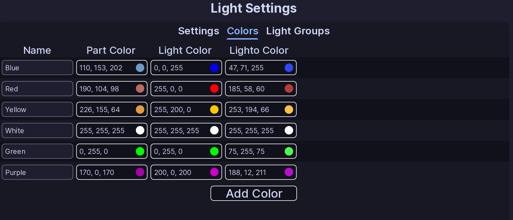

!!! tip ""
    Prefer videos? Check out our [YouTube playlist](https://youtube.com/playlist?list=PL7OqW0xeBKZTbk4QMl-6v3V_x11pZBV0W&si=e_bKE-MbL-B76wQk) for video guides on how to use the plugin.

Colors changes which colors are available for use in ELS patterns. You can add more colors, change the built-in colors, and delete custom colors.

## Colors

Each color has:

- **Name:** This is the name of the color that will show in EVCs UI.
- **Part Color:** This is the color that will be used for neon lights.
- **Light Color:** This is the color that will be used for light emitters.
- **Lighto Color:** This is the color that will be used for lightos.

The six built-in colors cannot be renamed or deleted.

Click **Add Color** to create your own color. Custom colors can be renamed, edited, and deleted.

!!! danger
    If you delete a custom color, EVC also removes it from any flashers, faders, or rotators that were using it.

## :material-check-circle: All Done!

Your colors, effects, and light groups are ready to use in ELS patterns.

Here are some recommended next steps to help you get started:

1. **[Light Groups](groups.md)**: Learn how to create powerful light groups.
2. [Siren Setup](../siren-setup.md): Learn how to setup and configure sirens.
3. [Function Setup](../functions/index.md): Learn how functions organize patterns and activations.

---

If you encounter any issues or have questions, feel free to [contact us on Discord](https://redon.tech/discord).
