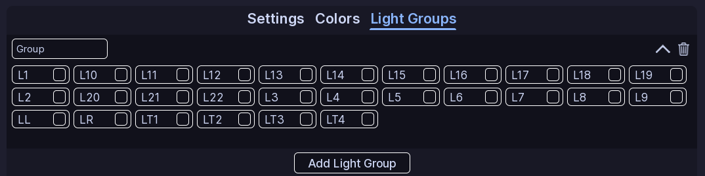

!!! tip ""
    Prefer videos? Check out our [YouTube playlist](https://youtube.com/playlist?list=PL7OqW0xeBKZTbk4QMl-6v3V_x11pZBV0W&si=e_bKE-MbL-B76wQk) for video guides on how to use the plugin.

## What are Light Groups?

Light groups allow you to control several lights using one *virtual* light!

So for example, if you had a DVI pattern you could have a DVI1 and DVI2 light group with all your vehicles lights in them. And then you could fade DVI1 and DVI2 without having to make faders for each individual light. This is especially useful for vehicles with a lot of lights.

## Light Groups

Click **Add Light Group** to create one. And then choose a name for it. You can rename or delete light groups at any time.

Click on the group to expand it, and select the lights you want to add. Hold **Left Shift** while selecting lights to select a range.

!!! note "Custom Vehicles"
    If you are using a custom vehicle, the lights here are determined off of the lights in your patterns. A good idea is to make a fake function with a pattern that has all your lights in it.

## :material-check-circle: All Done!

Your colors, effects, and light groups are ready to use in ELS patterns.

Here are some recommended next steps to help you get started:

1. **[Function Setup](../functions/index.md)**: Learn how functions organize patterns and activations.
2. [Siren Setup](../siren-setup.md): Learn how to setup and configure sirens.
3. [Creating a Pattern](../../patterns/flashers.md): Learn how to create your first pattern.

---

If you encounter any issues or have questions, feel free to [contact us on Discord](https://redon.tech/discord).
