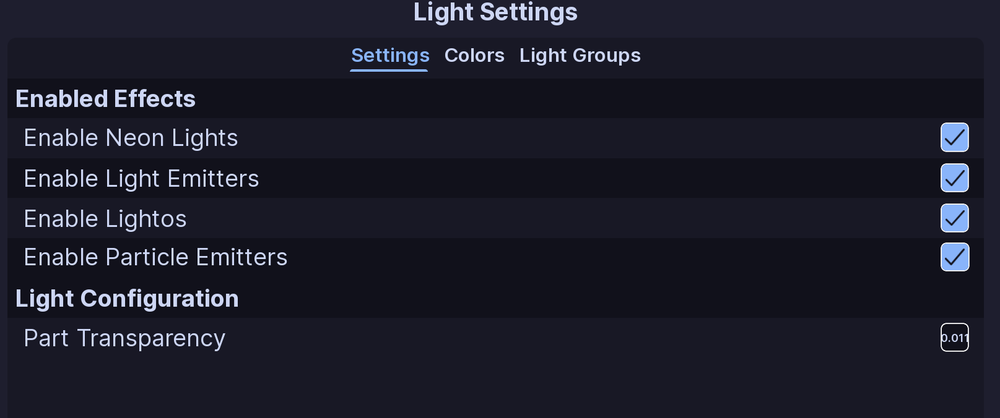

!!! tip ""
    Prefer videos? Check out our [YouTube playlist](https://youtube.com/playlist?list=PL7OqW0xeBKZTbk4QMl-6v3V_x11pZBV0W&si=e_bKE-MbL-B76wQk) for video guides on how to use the plugin.

Use **Light Settings** to control how the lights on your vehicle behave.

## Settings

### Enabled Effects

These options control which light types EVH changes:

- **Enable Neon Lights:** Standard lights that work by just changing the transparency of the part. These lights are the most common and are used for most lightbars and other lights.
- **Enable Light Emitters:** Light emitters are any `Light` instance type on Roblox. This is what causes your lights to show on the ground and walls around your vehicle. 
- **Enable Lightos:** Support for `SurfaceGui` and `ImageLabel` instances. 
- **Enable Particle Emitters:** Support for `ParticleEmitter` instances. Disabled by default.

!!! note
    This only controls what EVH will work with. You still must add the required effects to your light parts yourself. (Vehicles made with the EVC plugin will already have neons, light emitters, and lightos added to their lights)

### Part Transparency

**Part Transparency** controls the transparency used for neon lights when enabled. Using the default `0.011` helps lights shine through glass and other transparent parts. If your lights are not showing up, try changing this value.

## :material-check-circle: All Done!

Your colors, effects, and light groups are ready to use in ELS patterns.

Here are some recommended next steps to help you get started:

1. **[Colors](colors.md)**: Learn how to configure colors.
2. [Light Groups](groups.md): Learn how to create powerful light groups.
3. [Function Setup](../functions/index.md): Learn how functions organize patterns and activations.

---

If you encounter any issues or have questions, feel free to [contact us on Discord](https://redon.tech/discord).
