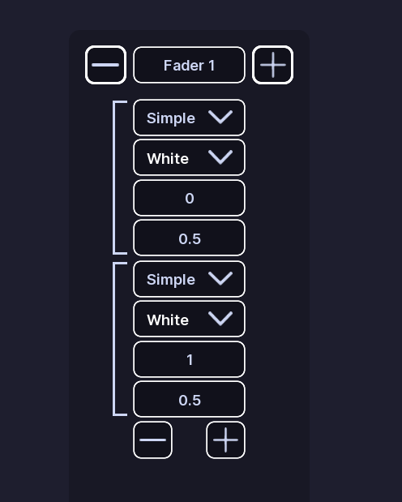
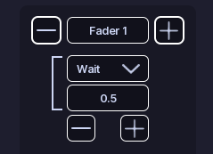
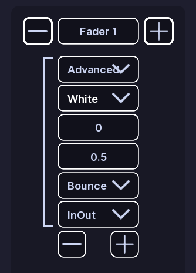
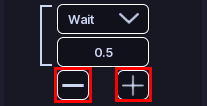

# Faders

!!! tip ""
    Prefer videos? Check out our [YouTube playlist](https://youtube.com/playlist?list=PL7OqW0xeBKZTbk4QMl-6v3V_x11pZBV0W&si=e_bKE-MbL-B76wQk) for video guides on how to use the plugin.

## What is a fader?

Faders smoothly change a light over time.

A fader section controls one light and contains a list of steps.

---

## Create a fader

1. Open a pattern.
2. Open **Faders**.
3. Click **Add Section**.
4. Enter the light name you want to control.

You can add multiple steps to a section.

## Step types

Faders have three types of steps:

### Simple

A **Simple** step changes the light to a target transparency over a set amount of time.

It uses:

- **Time:** How long the step takes to complete
- **Goal:** The target transparency of the light. 0 is off, 1 is fully on.
- **Color:** The color while the step is active. This is set as soon as the step starts.

### Wait

A **Wait** step does not change the light.

It waits for the amount of time entered in **Time**, then moves to the next step.

### Advanced

**Advanced** steps are very uncommon and shouldn't need to be used. Advanced steps have the same settings as Simple steps, plus:

- **Easing Style:** Control the Roblox [easing style](https://create.roblox.com/docs/en-us/reference/engine/enums/EasingStyle).
- **Easing Direction** Control the Roblox [easing direction](https://create.roblox.com/docs/en-us/reference/engine/enums/EasingDirection).

These control how the change happens.

## Preview

Preview works exactly like [Flashers](flashers.md). Except it steps through the fader steps instead of flashing lights.

## Edit steps

Adding or removing steps is done with the **+** and **-** buttons on the bottom of the step list.

!!! danger ""
    When you change a step type, settings that do not apply to the new type are removed.

## :material-check-circle: All Done!

You have created a fading pattern for your vehicle.

Here are some recommended next steps to help you get started:

1. **[Rotators](rotators.md)**: Learn how to create a rotating pattern.
2. [Siren Setup](../../siren-setup.md): Learn how to set up and configure sirens.
3. [Light Settings](../els-setup/light-settings.md): Learn how to configure colors and light groups.

---

If you encounter any issues or have questions, feel free to [contact us on Discord](https://redon.tech/discord).
