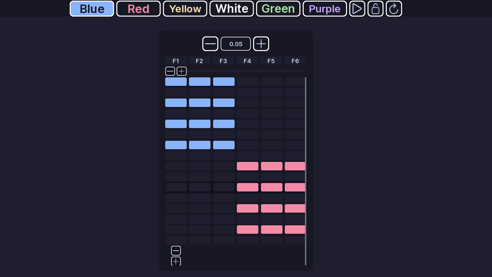
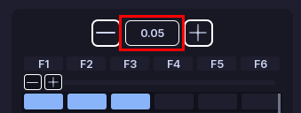
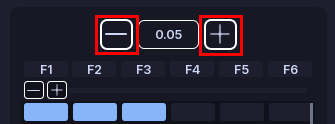

# Flashers

!!! tip ""
    Prefer videos? Check out our [YouTube playlist](https://youtube.com/playlist?list=PL7OqW0xeBKZTbk4QMl-6v3V_x11pZBV0W&si=e_bKE-MbL-B76wQk) for video guides on how to use the plugin.

Great! Now that you have a pattern, let's add some flashing lights to it.

## What is a flasher?

Flashers are lights that simply turn on and off in a pattern. They are the most common type of light used on emergency vehicles today!

In our plugin flashers are represented as a grid of cells. 

- Each **column** is a light
- Each **row** is a step

The wait time determines how long each row is active before moving to the next row.

---

## Create a flasher

1. Open a pattern.
2. Open **Flashers**.
3. Click **Add Section**.
4. Add the lights you want to control.

Enter the exact light name used by the vehicle.

## Set the lights

Choose a color for a cell to turn the light on with that color. 

??? tip "The fast way to switch colors"
    You can switch colors quickly by using the `Q-Y` on your keyboard. 

Set a cell to **None** to turn the light off.

You can also draw across the grid:

- **Left click** adds the selected color.
- **Right click** clears the cell.
- When drawing is locked, you can limit drawing to the selected column.

## Wait time

Each section has a **Wait Time**.

It controls how long that row stays active before moving to the next row.

A lower value makes the pattern move faster.

## Preview

Use **Play** button or `P` on your keyboard to preview the pattern.

Use **Refresh** button to reset the preview.

---

## Multiple sections

Click **+** button on your existing flasher section (its to the right of the wait time!) to add another flasher section.

Use the **-** button on the other side to remove a section. If you want to delete without a confirmation dialog, hold **Shift** while clicking the **-** button.

## :material-check-circle: All Done!

You have created a flashing pattern for your vehicle.

Here are some recommended next steps to help you get started:

1. **[Faders](faders.md)**: Learn how to create a fading pattern.
2. [Rotators](rotators.md): Learn how to create a rotating pattern.
3. [Light Settings](../els-setup/light-settings.md): Learn how to configure colors and light groups.

---

If you encounter any issues or have questions, feel free to [contact us on Discord](https://redon.tech/discord).
