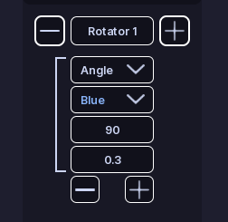
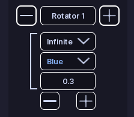
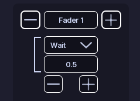
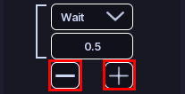

# Rotators

!!! tip ""
    Prefer videos? Check out our [YouTube playlist](https://youtube.com/playlist?list=PL7OqW0xeBKZTbk4QMl-6v3V_x11pZBV0W&si=e_bKE-MbL-B76wQk) for video guides on how to use the plugin.

Rotators move a light through different angles.

A rotator section controls one light and contains a list of steps.

## Create a rotator

1. Open a pattern.
2. Open **Rotators**.
3. Click **Add Section**.
4. Enter the light name you want to control.

## Step types

Rotators also have three types of steps:

### Angle

An **Angle** step moves the light to the angle specified in **Angle**. The angle is in degrees, and 0 is the default angle of the light.

It also uses:

- **Color:** The color while the step is active. This is set as soon as the step starts.
- **Velocity:** The speed at which the light rotates to the target angle. A higher number means a faster rotation. Read more below about how velocity works.

### Infinite

An **Infinite** step keeps the light rotating forever. Any steps after an Infinite step will never be reached.

It uses:

- **Color:** The color while the step is active. This is set as soon as the step starts.
- **Velocity:** The speed at which the light rotates. A higher number means a faster rotation. Read more below about how velocity works.

### Wait

A **Wait** step does not change the rotation.

It waits for the amount of time entered in **Time**, then moves to the next step.

## Preview

Preview works exactly like [Flashers](flashers.md). Except it steps through the fader steps instead of flashing lights.

## Edit steps

Adding or removing steps is done with the **+** and **-** buttons on the bottom of the step list.

!!! danger ""
    When you change a step type, settings that do not apply to the new type are removed.

## :material-check-circle: All Done!

You have created a rotating pattern for your vehicle.

Here are some recommended next steps to help you get started:

1. **[Siren Setup](../../siren-setup.md)**: Learn how to set up and configure sirens.
2. [Function Setup](index.md): Learn how functions organize patterns and activations.
3. [Customize Activations](./activations.md): Learn how to customize a functions activations.

---

If you encounter any issues or have questions, feel free to [contact us on Discord](https://redon.tech/discord).
